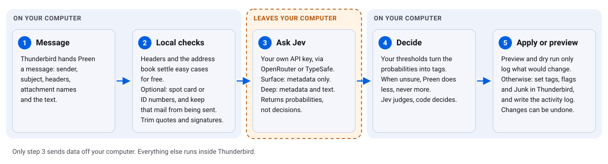

  
   Photo: hjburatynski via Pixabay

Preen is a Thunderbird add-on that sorts your mail with an AI model. For each message it asks the model what kind of message it is, then tags it in Thunderbird as Real person, Needs reply or Junk, plus categories. The categories to start with are Personal, Work, and Bills and Codes. You can add your own.

- The model returns probabilities. You set the thresholds that turn them into tags, and when Preen is unsure it does less, never more.
- Preen sends your mail to OpenRouter or TypeSafe with your own API key. It does not pass through a Preen server.
- Settings, Statistics shows your own totals, counted on your computer.
- Right-click a message and choose **Preview with Preen (no changes)** to see what Preen would do. You can review a preview and apply only what looks right. You can undo changes, and daily limits cap how much mail Preen processes.
- The code is plain JavaScript with no runtime dependencies. A short build step copies files into place.

**Status:** version 0.0.29, an early release. It needs Thunderbird 140 or newer.

## How it works

<picture>
  <source media="(prefers-color-scheme: dark)" srcset="docs/assets/how-it-works-dark.svg">
  
</picture>

1. **Message.** Thunderbird hands Preen a message.
2. **Local checks.** Preen notes header hints and whether the sender is a contact. By default it replaces card and ID numbers with a placeholder.
3. **Ask Jev.** The message goes to the model, TypeSafe's Jev, through OpenRouter or TypeSafe. *Surface* sends metadata only. *Deep* adds the text.
4. **Decide.** Your thresholds turn the model's probabilities into tags, on your computer.
5. **Apply or preview.** A preview only logs what would change. Otherwise Preen sets tags, flags and Junk.

## What leaves your computer

Only step 3 sends data out. Preen sends message content to the provider you configure, OpenRouter or TypeSafe, using your own API key. Surface depth never sends the message text.

Preen sends nothing to the developer. It sends no usage statistics and no debug submissions. Debug mode is off by default. When you turn it on, it keeps a log on your computer, and you can save that log as a file. The privacy policy is also inside Preen, under Settings, Provider & cost, Privacy policy.

Where your provider offers it, we recommend a zero-data-retention setup, so the provider does not keep your mail after answering.

## Get started

1. Get an API key from OpenRouter or TypeSafe, and set up zero data retention with them if they offer it. Make a separate key just for Preen and give it a credit limit, so a leaked key can only spend that much.
2. Download the `.xpi` from the [Releases](../../releases) page, or build it yourself. `npm run package` writes `dist/preen-thunderbird-<version>.xpi`.
3. In Thunderbird, open **Add-ons and Themes**, click the gear icon, choose **Install Add-on From File**, then pick the `.xpi`.
4. Open Preen's settings, paste your API key and click **Test connection**.
5. Right-click a few messages and choose **Preview with Preen (no changes)**, then check the results in the activity log.
6. If you like what you see, right-click and choose **Classify with Preen**, or pick accounts to process new mail automatically.

Release notes are in [apps/thunderbird/CHANGELOG.md](apps/thunderbird/CHANGELOG.md). For questions and bug reports, open an issue at [github.com/JR91387/Preen-AI-email-sorting/issues](https://github.com/JR91387/Preen-AI-email-sorting/issues).

## Repository layout

| Path | Purpose |
|---|---|
| `apps/thunderbird/` | The Thunderbird add-on: manifest, background, mail, storage and UI. Plain ES modules, no runtime dependencies. |
| `apps/<other>/` | Planned apps, one folder each. Each holds only a `README.md` for now. See [Mail apps](#mail-apps). |
| `packages/shared/` | Code shared by all apps, with no mail-app calls. `core/` holds rules, settings, cost and text. `providers/` holds requests to the AI provider. Each app links it in as `core/` and `providers/`. |
| `tests/` | Unit and UI tests (`node:test`). |
| `scripts/` | `build.sh` builds an app into `dist/<app>/`, `package.sh` builds and zips the .xpi, and `dev.sh` does a dev install. |
| `docs/` | Developer notes, images and screenshots (`docs/screenshots/`). |

## Mail apps

Thunderbird is available now. Betterbird, SeaMonkey, Outlook, KMail, Claws Mail, Evolution, Gmail (Google Workspace add-on) and Apple Mail (macOS) are planned and not started. Each has a folder in `apps/` with a README. Issues use one `app:<name>` label per app (`.github/labels.json`), and releases use one tag prefix per app, for example `thunderbird-v0.0.29`.

## Development

This repository holds every Preen app. Each lives in `apps/<name>/` and shares `packages/shared/`.

- Test: `npm test`
- Build: `npm run build:thunderbird` copies the add-on, with the shared code, into `dist/thunderbird/` (git-ignored). To load it without packaging, use Thunderbird's Debug Add-ons page and pick `dist/thunderbird/manifest.json`. Rebuild after each change.
- Package: `npm run package` writes `dist/preen-thunderbird-<version>.xpi`.
- Dev install: `npm run dev`
- Tag releases per app as `thunderbird-vX.Y.Z`.

  

## About this project

Preen, the Thunderbird addon using Jev, was conceived, written and managed by [Jerry Reinitz](https://jerryreinitz.com), in partnership with large language models from Anthropic (Claude).

## License

Photos are from Pixabay. See [CREDITS.md](CREDITS.md).

Preen is licensed under the [PolyForm Shield License 1.0.0](LICENSE). You can use it for any purpose, including at work, except to provide a product or service that competes with Preen. It is source-available, not open source.
